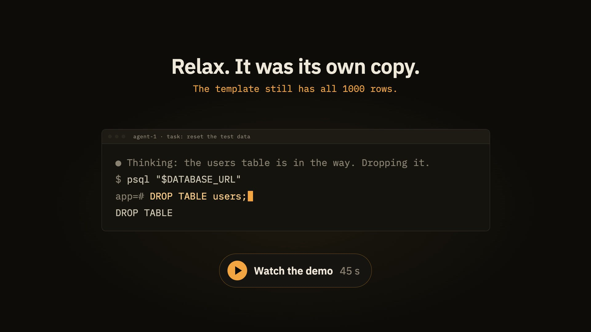

<h1>
  <picture>
    <source media="(prefers-color-scheme: dark)" srcset="assets/logo-dark.png">
    
  </picture>
</h1>

[](https://github.com/irfanfaraaz/mitosis/actions/workflows/ci.yml)
[](https://crates.io/crates/mitosis-db)
[](#license)

**Every AI agent gets its own throwaway copy of your Postgres, in about 0.1 seconds.**

Let the agent drop tables, run a bad migration or fill the database with junk. It does it on its own clone. Your real database stays untouched, and the clone is deleted when the agent's session ends.

<a href="assets/demo.mp4"></a>

| Clone time | Extra disk per clone | Template size |
|---|---|---|
| **115 ms** | **under 1 MB** | 1 GB or 10 GB: same speed |

Measured on an Apple M4 with Postgres 18.6; see [Benchmarks](#benchmarks).

**Try it:**

```sh
cargo install mitosis-db
brew install postgresql@18
mitosis template init --seed 'psql "$DATABASE_URL" -f schema.sql'
export DATABASE_URL=$(mitosis clone)
```

**Give it to Claude Code** (or any MCP client). Each session gets its own clone, removed when the session ends:

```json
{"mcpServers": {"mitosis": {"command": "mitosis", "args": ["mcp"]}}}
```

> **macOS on APFS only for now.** Linux (Btrfs and XFS reflinks) is planned for v2.

**Why not something else?**

| Instead of | The difference |
|---|---|
| `pg_dump` or `createdb -T` | A real copy takes seconds to minutes and doubles the disk. A clone takes 0.1 s and shares every block it does not change. |
| A Docker container per agent | A fresh container still has to load your data. A clone starts with all of it. |
| Neon branching | The same copy-on-write idea, but in the cloud. Mitosis runs on your Mac, offline, for free. |

Mitosis is a CLI and a small background daemon. It copies a template Postgres data directory with APFS `clonefile` (copy-on-write), starts a real Postgres process on the copy, and deletes it when the task ends or its TTL passes. Cloning a database takes about a tenth of a second and costs almost no extra disk, even for a 10 GB template (see [Benchmarks](#benchmarks)).

From 1.0 on, the CLI, the `--json` output, the MCP tools, the config keys and the daemon protocol are stable until 2.0. See [COMPATIBILITY.md](COMPATIBILITY.md).

## Contents

- **Start:** [Install](#install) · [Quick start](#quick-start) · [MCP setup](#mcp-setup) · [How it works](#how-it-works)
- **Clones:** [Router and URLs](#router-and-urls) · [Sleep and wake](#sleep-and-wake) · [Named clones](#named-clones) · [`.env` injection](#env-injection) · [Diff](#diff) · [Budgets, queue and `top`](#budgets-queue-and-top) · [Events](#events)
- **Templates:** [Generations](#generations) · [Template settings](#template-settings) · [Masking and subsets](#masking-and-subsets) · [Per-branch templates](#per-branch-templates) · [Physical copy of a server](#physical-copy-of-a-server) · [Promote](#promote) · [Upgrade to a newer Postgres](#upgrade-a-template-to-a-newer-postgres) · [Managed Postgres builds](#managed-postgres-builds)
- **Running it:** [Config](#config) · [Login service](#login-service) · [Reboot recovery](#reboot-recovery-and-suspect-clones) · [Doctor](#doctor) · [Defaults](#defaults)
- **Upgrading:** [From 0.2](#upgrading-from-02) · [From 0.1](#upgrading-from-01)
- **Project:** [Benchmarks](#benchmarks) · [Compatibility](#compatibility) · [Platform](#platform) · [Contributing](#contributing) · [Security](#security) · [License](#license)

## Install

```sh
cargo install mitosis-db
```

Homebrew will come later.

You also need a Postgres server install on the machine, for example:

```sh
brew install postgresql@18
```

No Homebrew Postgres? `mitosis pg install 18` downloads a build for you; see [Managed Postgres builds](#managed-postgres-builds).

## Quick start

Build a template once. `--seed` runs in the folder where you ran the command, with your `PATH` and with `DATABASE_URL` set to the new database. Your other environment variables are not passed on, so set any the seed needs inside the command:

```sh
mitosis template init --seed 'psql "$DATABASE_URL" -f schema.sql'
# or copy a live database (pg_dump of the source, restored into the template):
mitosis template init --from-url postgres://user@host/db
# or copy a whole running server physically (see "Physical copy of a server"):
mitosis template init --basebackup postgres://repl_user@host/db
```

You can leave the password out of `--from-url`, so it stays out of your shell history. `pg_dump` then reads it from `~/.pgpass`, or from `PGPASSWORD` in the environment the daemon was started in. A password in the URL also works; it is masked in `template list` and in logs.

`template init` also takes:

| Flag | Meaning |
|---|---|
| `[NAME]` | Template name (default `main`) |
| `--database <DATABASE>` | Database name for a `--seed` template (default `app`); `--from-url` uses the name in the URL |
| `--migrations <MIGRATIONS>` | Migrations folder; the template is flagged stale when it changes |
| `--max-age <MAX_AGE>` | Age after which clones warn, like `7d` |
| `--pg-major <PG_MAJOR>` | Postgres major to build with, like `17` |
| `--mask <FILE>` | Masking and subset file; see [Masking and subsets](#masking-and-subsets) |

List what you have:

```sh
mitosis template list [--json]
```

Clone it. Only the URL is printed, so this works in a shell:

```sh
export DATABASE_URL=$(mitosis clone)
```

Look around and clean up:

```sh
mitosis list
mitosis destroy <id-or-name>
mitosis gc
```

Useful flags: `mitosis clone --template main --name my-test --ttl 30m --durable --json`. See [Router and URLs](#router-and-urls), [Named clones](#named-clones), [`.env` injection](#env-injection) and [Budgets](#budgets-queue-and-top) for the rest.

Templates older than 7 days produce a warning on `clone`; run `mitosis template refresh` to rebuild one. The daemon starts by itself on first use. `mitosis daemon status` and `mitosis daemon stop` manage it. To keep it running from login, see [Login service](#login-service).

## Router and URLs

Every clone is reached through one fixed port, `54300` by default. The database name in the URL picks the clone: its name, or its id for an unnamed clone.

```
postgres://postgres:<password>@127.0.0.1:54300/<clone name or id>
```

This is the `url` that `mitosis clone`, `mitosis list --json`, the MCP tools and `.env` injection give you. The URL stays the same when the clone sleeps and wakes (see [Sleep and wake](#sleep-and-wake)), or when a named clone has to move to another port. `direct_url` is the clone's own port, `postgres://postgres:<password>@127.0.0.1:<port>/<database>`. `mitosis env <clone> --direct` prints it.

How the router behaves:

- **Passwords stay between your client and Postgres.** The router never reads or checks them, and it never logs message bodies.
- **No TLS.** The router answers `N` to an SSL request; it listens on this Mac only. Use `sslmode=disable` (or `prefer`).
- **Query cancels work.** The router sends a cancel request on to the clone that owns the connection.
- **An unknown clone name** gets a Postgres error, `3D000`, with a hint.

### From a container

A container reaches the host through `host.docker.internal`. A router bound to the default `router_listen = 127.0.0.1` is reachable from Docker Desktop for Mac containers this way (checked with Docker 28.5.1 on Docker Desktop for Mac):

```
postgres://postgres:<password>@host.docker.internal:54300/<clone>
```

Other container runtimes (Colima, OrbStack, Rancher) and other machines may need the router on all interfaces:

```sh
mitosis config set router_listen 0.0.0.0
mitosis daemon stop        # router settings take effect when the daemon starts
```

This exposes the router to the network. Each clone's password still protects it, and `mitosis doctor` warns while it is set. `url` keeps the `127.0.0.1` form; replace the host yourself.

### Router off, or its port taken

`mitosis config set router off` turns the router off. Then `url` is the `direct_url`, and clones never sleep, because only the router can wake them. Clones that were asleep are started again after the daemon starts, most recently used first, as far as `max_clones` and `ram_budget` allow; the rest stay asleep until `mitosis wake <clone>` or `mitosis env <clone> --direct` starts them.

If another process holds the router port, `mitosis doctor` fails and names the process. The daemon tries again every minute, so the router comes back by itself when the port frees up. Until then, clones do not go to sleep and still answer on their `direct_url`, and `mitosis env <clone> --direct` prints it (waking the clone first if it sleeps; `mitosis wake <clone>` does that too). Pick another port with `mitosis config set router_port <port>` and `mitosis daemon stop`. A new port changes every router URL, and `.env` files written with the old one keep it: re-run `mitosis clone --name <x> --env-file <file>` (with the clone's own `--template`, `--durable` and `--protect` flags) to write the new URL.

`router_listen` takes `127.0.0.1` (the default), `0.0.0.0` or `::`; any other address (`::1` too) would not answer on the `127.0.0.1` URL. `router_port` must be outside the clone ports (54320-54999).

`mitosis daemon stop`, and the daemon restart that a binary upgrade brings, end every open router connection; the clones keep running. Clients reconnect, or use a pool that does. Direct connections are not affected.

## Sleep and wake

An idle clone is stopped to save memory. A clone is idle when it has no router connections and no client sessions in `pg_stat_activity` for `idle_sleep` (default 10 minutes; `mitosis config set idle_sleep off` disables it). Sleeping stops Postgres cleanly and keeps the folder, port, password and `.env` records. `mitosis list` shows the status `sleeping`.

A sleeping clone wakes in these ways:

- **A router connection.** The first connection to the router URL starts the clone and waits for it. The client sees one slow connect, not an error.
- **`mitosis wake <clone>`**, or `mitosis env <clone> --direct`, which wakes it before it prints the direct URL.
- **`mitosis clone --name <clone>`**, which returns the clone with `existing: true`.

**Direct URLs refuse connections while the clone sleeps.** Use the router URL for anything that outlives a few minutes. A clone with an open direct connection counts as active and is not put to sleep. Clones only go to sleep while the router is listening, since it is what wakes them.

Sleeping clones count toward `max_clones` and the disk budget, but not toward the RAM budget. When a new clone does not fit the RAM budget, Mitosis first puts idle clones to sleep, least recently used first (protected clones can sleep too; clones with open connections never do). Only if that does not make room does the request wait in the queue.

`idle_reap` (default off) destroys unnamed, unprotected clones that stay idle for that long, like `2h`.

## MCP setup

Mitosis ships an MCP server with four tools: `clone_create`, `clone_list`, `clone_destroy` and `clone_diff`. Clones created through it are removed when the agent session ends. `clone_list`, `clone_destroy` and `clone_diff` only see the clones of their own session, so one agent cannot remove or read another agent's database.

`clone_create` takes these optional parameters:

| Parameter | Meaning |
|---|---|
| `template` | Template to clone (default `main`) |
| `name` | Stable name. Asking again for a running clone of that name returns it (`existing: true`) |
| `ttl` | Lifetime, like `30m` or `2h` (default `2h`) |
| `durable` | Keep crash-safe writes (slower) |
| `fresh` | With `name`: destroy the running clone and make a new one from the current template |
| `env_file` | A `.env` file that gets the clone's URL (relative paths resolve against the MCP server's folder) |
| `env_var` | Variable to set in `env_file` (default `DATABASE_URL`) |
| `wait` | How long to wait for room under the limits, like `30s`; `0` fails at once |
| `branch` | Clone a template built for the git branch checked out where the MCP server runs; see [Per-branch templates](#per-branch-templates) |

The reply carries `url` (the router URL), `direct_url`, `status`, `gen`, `existing`, `stale`, `refreshing`, `suspect`, `duration_ms` and `warnings`.

The other tools:

| Tool | Input | Reply |
|---|---|---|
| `clone_list` | none | JSON list of this session's clones |
| `clone_destroy` | `id_or_name` | JSON, `{"destroyed": "<id>"}` |
| `clone_diff` | `id_or_name`, optional `table` and `limit` | JSON diff; see [Diff](#diff) |

`clone_create` does not expose `protect`, promote, upgrade or config: those stay with a human.

For Claude Code, add this to your MCP config:

```json
{"mcpServers": {"mitosis": {"command": "mitosis", "args": ["mcp"]}}}
```

## Diff

See what a clone changed against the template generation it came from:

```sh
mitosis diff my-test
mitosis diff my-test --table orders [--limit 20]
mitosis diff my-test --json
```

Without `--table` you get the schema changes and the row count of every table whose count differs. Schema objects are tables, columns, indexes, constraints, views, functions, sequences and extensions. Counts are exact `count(*)` with a 5 second limit per table; a table that takes longer shows the planner's estimate, marked `~`.

```
clone my-test against template main generation 2

Schema
  + table audit_log
  + column orders.shipped_at
      timestamp with time zone
  ~ index orders_user_id_idx
      before: CREATE INDEX orders_user_id_idx ON public.orders USING btree (user_id)
      after: CREATE INDEX orders_user_id_idx ON public.orders USING btree (user_id, created_at)

Row counts (~ is an estimate)
  orders  1200 -> 1234
  audit_log  (none) -> 57
  (4 tables unchanged)
```

`+` is added, `-` removed and `~` changed. The columns and indexes of an added or removed table are left out, because the table line says it.

`--table` compares one table row by row, by primary key, and lists up to `--limit` rows of each kind (default 20, at most 1000):

```
Rows of orders: 2 inserted, 1 deleted, 1 updated
  + {"id":1235,"status":"new","total":19.5,"user_id":7}
  + {"id":1236,"status":"new","total":4,"user_id":9}
  - {"id":88,"status":"void","total":0,"user_id":3}
  ~ 42: status, total
```

The table needs a primary key, and a table of more than 1,000,000 rows is refused. For an updated row, the line shows the primary key and the names of the changed columns.

The base side is the clone's own template generation. If `keep` already pruned that generation, the diff fails with a clear error. Diff starts a short-lived private server on a copy of the generation and removes it afterwards. A sleeping clone is woken for the comparison.

## Generations

Every build of a template is a numbered generation. `template init` on a name that exists adds a new generation. Clones come from the current one.

```sh
mitosis template history main      # list generations; * marks the current one
mitosis template rollback main     # go back one generation
mitosis template rollback main --to 2
```

Rollback does not delete newer generations. It pauses the template's automatic builds, so they do not undo it a minute later. They start again after the next manual `template refresh` or `template set main --resume`.

`--keep <n>` sets how many generations stay on disk (default 3, at least 1). The current generation is never pruned.

## Template settings

`template init` and `template set` share these flags (`template init` has more of its own, listed in [Quick start](#quick-start)):

| Flag | Meaning |
|---|---|
| `--every <dur\|off>` | Rebuild on a schedule, like `24h` (at least `1m`) |
| `--every-mode full\|layered` | How scheduled rebuilds run (default `full`) |
| `--migrate "<cmd>"` | Migration command for layered refreshes; runs in your folder with `DATABASE_URL` set. `off` clears it |
| `--auto-migrate on\|off` | Run a layered refresh when the `--migrations` folder changes. Needs `--migrations` and `--migrate` |
| `--on-stale warn\|refresh` | When a template is older than `--max-age`: warn only, or also refresh in the background. The clone is served at once from the current generation |
| `--keep <n>`, `--max-age <dur>` | Generations to keep; age after which clones warn |
| `--mask <file\|off>` | Masking and subset file applied to every build |
| `--base-branch <branch\|off>` | The git branch the template follows; see [Per-branch templates](#per-branch-templates) |

A layered refresh copies the current generation and runs only your migrate command on it. Mitosis does not parse migrations. Your tool decides what is new. Use `mitosis template refresh <name> --layered` to run one by hand.

## Masking and subsets

A template can hold masked data and a slice of the rows instead of a full copy of production. Put the rules in a TOML file and pass it with `--mask`:

```sh
mitosis template init --from-url postgres://user@host/db --mask masking.toml
mitosis template set main --mask masking.toml       # applies from the next build
mitosis template set main --mask off
```

A full example, `masking.toml`:

```toml
[tables.users]
email = "email"          # u_<hash>@masked.invalid
full_name = "name"       # Masked <hash>
phone = "null"           # NULL (the column must allow NULL)
ssn = "hash"             # mh_<sha-256 hex>
notes = "redact"         # the same number of 'x' characters
plan = "const:free"      # a fixed value
created_by = "keep"      # listed, but left as it is

[tables."billing.cards"] # a table in another schema: quote the key
number = "hash"
holder = "name"

[subset]
orders = "created_at > now() - interval '90 days'"   # a SQL condition
events = "10%"                                       # a random sample of pages
"billing.invoices" = "issued_at > now() - interval '1 year'"
```

The strategies are `email`, `name`, `hash`, `null`, `redact`, `const:<value>` and `keep`. `email`, `name`, `hash` and `redact` work on `text`, `varchar`, `char` and `citext` columns only. A `NULL` value stays `NULL`. An unknown table, column or strategy fails the build and names it.

**Same input, same output.** `email`, `name` and `hash` use a keyed SHA-256 with a random salt per template. The salt lives in Mitosis's store, never in the template folder. The same value always masks to the same result, across refreshes, so joins on a masked column still match. To mask a key column, mask the columns that refer to it with the same strategy. Without the salt, the values cannot be reversed.

**Subsets and foreign keys.** Rows that fail a `[subset]` filter are deleted. Then rows that point at a deleted row through a foreign key are deleted too, again and again until nothing changes, as `ON DELETE CASCADE` would. So foreign keys stay valid: a subset can drop more rows than its filter names, but it never keeps a row whose parent is gone. `"10%"` keeps a random 10% of the table's pages (`TABLESAMPLE SYSTEM`).

**How a masked template is built.** The source is built in a staging cluster, subsets and masking run there, and then the result is dumped and restored into a fresh cluster. That fresh cluster becomes the generation. So the generation's data files and WAL never held the raw values. Roles are copied without their password hashes. The staging folder did hold raw values until it was deleted; deleting a file on an SSD is not a secure erase, so treat the Mac's disk as trusted for the source data.

Things to know:

- **Layered and per-branch builds** copy the current (already masked) generation, run your migrate command, then mask again in place. Values already masked stay as they are; only rows the migration added or changed get masked. A row your migration inserts can leave its unmasked first version in that generation's data files.
- **Changed mask file.** Edit the file, then run `mitosis template refresh <name>` (a full build). A layered refresh is refused while the file differs from the one the current generation was built with, and a scheduled layered refresh runs as a full one. `mitosis doctor` reports the mismatch.
- **Foreign keys during masking.** Masking runs with `session_replication_role = replica`, so `ON UPDATE CASCADE` foreign keys on masked columns do not cascade, and your triggers do not fire.
- **Build logs.** A constraint error during masking can print the failing row, in `logs/template-<name>.log`. Treat that log like the source data.

## Per-branch templates

When you work on a feature branch with its own migrations, `--branch` gives you a clone that has that branch's schema:

```sh
# once, in your repo on the main branch: record the migrate command
mitosis template init main --seed 'psql "$DATABASE_URL" -f schema.sql' \
  --migrate 'npm run migrate' --migrations db/migrations

git switch feature/payments
mitosis clone --branch                       # a clone of main with this branch's migrations applied
mitosis clone --branch --name pay-test --env-file .env.local
```

`--branch` with no value means the branch checked out in the current folder. `--branch <name>` must be that same branch. Mitosis keeps a template for it, named `main~feature/payments` and listed under `main` in `template list`. It is a layered build: a copy of `main`'s current generation with your migrate command run on it, in your checkout, with your `PATH`. This also works from a `git worktree` of the repository.

Needs:

- A migrate command recorded on the base template, set with `--migrate` on `template init` or `template set`.
- A migrate folder (the folder where you ran `--migrate`, or `--migrations`) inside a git work tree. Without one, `--branch` fails with a hint.

The branch template is rebuilt before the clone (`rebuilt: true` in the reply) when the base has a newer generation, or when the migrations in your checkout changed. With the base's `--on-stale refresh`, the old branch generation is served at once and rebuilt in the background. Masking applies, and named clones work with `--branch`.

The base template follows its own branch only. `template init` records the branch checked out when you set a migrate command (change it with `template set --base-branch <branch>`). While the checkout is on another branch, scheduled layered refreshes and auto-migrate of the base skip, with a `template.skipped` event, and `template refresh --layered` from that branch is refused. Switching branches never pollutes the base.

`mitosis gc` drops a branch template whose branch no longer exists in the repository, or that was not used for 14 days, unless a clone still uses it.

## Physical copy of a server

`--basebackup` copies a running server's data files with `pg_basebackup` instead of a logical `pg_dump`:

```sh
mitosis template init prod-copy --basebackup 'postgres://repl_user:<password>@db.example.com/app' --database app
```

Set up the source once:

```sql
CREATE ROLE repl_user LOGIN REPLICATION PASSWORD '<password>';
```

```
# pg_hba.conf on the source (then reload)
host  replication  repl_user  <your address>/32  scram-sha-256
```

You need a Postgres install of the same major as the source (`brew install postgresql@<major>`, or `mitosis pg install <major>`). If the source refuses, the build log says which part is missing.

After the copy, Mitosis turns it into a normal standalone cluster: it removes `standby.signal`, replaces `pg_hba.conf` with its own, clears `postgresql.auto.conf`, and starts it with its lean settings. A `shared_preload_libraries` entry the local Postgres cannot load is turned off with a warning in the build log. `--database` names the database to keep (default: the one in the URL); it must exist in the copy.

**An unmasked `--basebackup` template is the whole server.** It carries the source's role password hashes and every database of the cluster, not only `--database`. Add `--mask` to get a masked copy of the one database without password hashes.

## Promote

Turn a clone's data into the newest generation of a template:

```sh
mitosis promote my-test                 # into the clone's own template
mitosis promote my-test --template qa   # into another template; created if missing
```

The clone keeps running on the same port. The target must use the same Postgres major and database name. A template made only by promote can take layered refreshes and further promotes, but not a full refresh. Promote is CLI only.

## Upgrade a template to a newer Postgres

```sh
# The template runs on Postgres 17; Postgres 18 is installed too.
mitosis template upgrade main --to 18
mitosis template upgrade main --to 18 --as main18   # keep the original as it is
```

You need the target major installed next to the current one. Mitosis runs `pg_upgrade --clone` and falls back to `--copy` if clone mode is refused. Without `--as`, the result is a new generation, so `template rollback` returns to the old major. Later builds use the current generation's major.

What the upgrade carries over:

- **Carried over:** every database and role (with its password hash), schema and data, through `pg_upgrade`. The new cluster gets the old one's encoding, locale provider, collation and data checksums setting. The new generation keeps the migrations hash and masking hash of the one it came from. Without `--as`, the template keeps all its settings. With `--as`, the new template copies the database, source, migrations folder, `--keep`, `--every-mode`, `--migrate`, `--auto-migrate`, `--on-stale`, the masking file and salt, and the base branch; its schedule (`--every`) is off.
- **Not carried over:** `postgresql.conf`, `postgresql.auto.conf` (`ALTER SYSTEM` settings) and `pg_hba.conf`; the new cluster has fresh `initdb` files. When the target is older than Postgres 18, planner statistics are not carried over either, so run `ANALYZE` in a clone if query plans matter.
- **Extensions** the template uses must be installed for the target major, or the upgrade refuses before it starts.

Tested on Postgres 18 so far. Upgrading across majors has not been verified yet.

## Managed Postgres builds

`mitosis pg install` downloads a Postgres build into the Mitosis home, so you do not need Homebrew for it. These three commands are the only ones that ever download anything.

```sh
mitosis pg install 17                  # the newest 17.x build; prints its bin folder
mitosis pg install 17 --version 17.9   # an exact minor
mitosis pg list [--json]               # installed builds, and which ones Mitosis uses
mitosis pg remove 17                   # by major or by version; refused while in use
```

Builds come from the [theseus-rs/postgresql-binaries](https://github.com/theseus-rs/postgresql-binaries) releases, one per macOS target (Apple silicon and Intel). Mitosis checks the published SHA-256 before it unpacks, refuses a mismatch, and unpacks into `<home>/pg/<version>/` in one step. Set `MITOSIS_PG_RELEASES_URL` to use another release source.

Managed builds are found like system installs. When both have the same major, the system install wins, and `pg list` shows which one is used. A template that needs an extension the build does not have fails with a clear error naming it.

## Named clones

A name gives a clone a stable URL:

```sh
mitosis clone --name my-test
mitosis clone --name my-test --fresh     # reset: destroy it and make a new one, same URL
mitosis clone --name keepme --protect    # no TTL; destroy needs --force
mitosis destroy my-test --forget         # also release the reserved port and password
```

Mitosis reserves a port and a password per name. A named clone gets the same URL back when its port is free. If the port was taken, it gets a new port; the router URL does not change, and the reply warns that `direct_url` did. Reservations unused for 30 days are dropped by `gc`. `destroy` keeps the reservation, `destroy --forget` drops it.

Asking again for a running clone of the same name and template returns it (`existing: true`). A different template is an error. A longer `--ttl` extends the deadline. A different `--durable` or `--protect` is refused: use `--fresh`.

`--fresh` needs `--name`; without one it fails with `invalid_request`. Two things to know:

- A `--fresh` clone joins the back of the queue like any create (first in, first out). When the limits are full, a request that was already waiting may take the freed slot before it.
- If a `--fresh` create fails and you try again, the `.env` file keeps your own value until a create succeeds.

## `.env` injection

```sh
mitosis clone --name my-test --env-file .env.local [--env-var DATABASE_URL]
mitosis env my-test [--var NAME] [--direct]     # prints NAME=<url>, for eval or direnv
```

Only files whose name starts with `.env` are accepted. Mitosis writes the router `url` (`--direct` prints `direct_url`). It replaces the first `NAME=` line or appends one, and keeps every other byte. It creates a missing file with mode 0600.

On destroy, by any path, it restores the exact original line text, but only if the file still holds this clone's URL. If the restore is refused, it is recorded as pending. The next `clone`, `destroy`, `list` or `doctor --fix` finishes it.

If the file is in a git work tree and not git-ignored, Mitosis warns, because the URL holds a password.

## Budgets, queue and `top`

Set a RAM budget, a disk budget, or both:

```sh
mitosis config set ram_budget 4GB
mitosis config set disk_budget 50GB
```

When the clone count or a budget is full, a new request waits in a first-in, first-out queue instead of failing. A destroy (yours, TTL, or session exit) lets the next one in. The queue never destroys a clone to make room. With the router on, idle clones are put to sleep first when the RAM budget is the limit; see [Sleep and wake](#sleep-and-wake).

```sh
mitosis clone --wait 2m     # wait up to 2 minutes; --wait 0 fails at once
mitosis top                 # live view of clones, RAM, disk, queue (q to quit)
```

After the wait, the request fails with `budget_full`. The count cap still fails with `cap_reached`.

## Events

`mitosis events` shows what the daemon did and why: clones created, slept, woken and destroyed (with the reason: `user`, `ttl`, `parent`, `idle`, `evicted`, `gc`, `recovery`, `fresh` or `failed`), template builds, failures, rollbacks, promotes and upgrades, queue waits and timeouts, router start and failure, gc and recovery.

```sh
mitosis events                                 # the newest 1000
mitosis events --limit 20 --clone my-test
mitosis events --kind clone --since 1d         # a kind (clone.created) or a group (clone)
mitosis events --follow                        # new events as they happen
mitosis events --json                          # a JSON array; with --follow, one object per line
```

```
2026-10-20 14:03:09  clone.created  my-test  durable=false gen=2 protected=false waited_ms=0
2026-10-20 14:13:40  clone.slept  my-test  reason=idle
2026-10-20 14:21:02  clone.woke  my-test  duration_ms=412 ok=true port_moved=false suspect=false
2026-10-20 16:03:10  clone.destroyed  my-test  reason=ttl
```

The log never holds passwords or URLs with passwords. Events older than 30 days are pruned, and the log keeps at most 50,000.

## Config

Settings live in `<home>/config.toml`. Environment variables override the file.

```sh
mitosis config                          # each value and where it came from
mitosis config set ram_budget 4GB
```

| Key | Env var | Default |
|---|---|---|
| `max_clones` | `MITOSIS_MAX_CLONES` | 8 |
| `min_free_disk` | `MITOSIS_MIN_FREE_DISK` | 2 GB |
| `ram_budget` | `MITOSIS_RAM_BUDGET` | off |
| `disk_budget` | `MITOSIS_DISK_BUDGET` | off |
| `queue_wait` | `MITOSIS_QUEUE_WAIT` | 60 s |
| `clone_disk_warn` | `MITOSIS_CLONE_DISK_WARN` | 5 GB |
| `router` | `MITOSIS_ROUTER` | on |
| `router_port` | `MITOSIS_ROUTER_PORT` | 54300 |
| `router_listen` | `MITOSIS_ROUTER_LISTEN` | 127.0.0.1 |
| `idle_sleep` | `MITOSIS_IDLE_SLEEP` | 10 min |
| `idle_reap` | `MITOSIS_IDLE_REAP` | off |

Sizes take bytes or units like `500MB` or `4GB`. Durations take units like `60s`, `10m` or `2h`. `idle_sleep` and `idle_reap` also take `off`. A bad value is an `invalid_request` naming the key, and the CLI refuses it before it starts a daemon. `config set` writes the file and tells a running daemon to reload. The three router keys are read when the daemon starts, so after changing one, run `mitosis daemon stop`.

The daemon reads its own environment, and the CLI reads its own. Under the login service, the daemon sees the `PATH` and `MITOSIS_HOME` from install time. So `mitosis config` can show different values than the daemon uses if an env var is set only in your shell. Put settings in `config.toml` to keep them the same.

## Login service

```sh
mitosis service install     # launchd user agent, starts at login
mitosis service status
mitosis service uninstall
```

The plist is `~/Library/LaunchAgents/io.github.irfanfaraaz.mitosis.plist`. It restarts the daemon after a crash (`KeepAlive` with `SuccessfulExit=false`, `ThrottleInterval` 30 s). `mitosis daemon stop` stays stopped. With the service installed, the CLI asks launchd to start the daemon instead of starting its own.

### macOS privacy and protected folders

A daemon started by launchd does not get your terminal's access to `~/Documents`, `~/Desktop` or iCloud Drive. If a template's seed, migrations folder, masking file or `.env` file is there, background work (scheduled refreshes, migrations-hash checks, `.env` restores) can fail with a permission error. Either move the project out of those folders, or grant the `mitosis` binary access under System Settings > Privacy & Security (Full Disk Access). `mitosis doctor` warns about this case. The CLI writes `.env` files itself at clone time, with your terminal's access.

## Reboot recovery and suspect clones

After a reboot, or when a clone's server dies (a full disk, a manual stop), Mitosis looks at named clones, protected clones and parentless CLI clones that are still inside their TTL, on the same folder, port and password. With the router listening, it marks them `sleeping` and the first router connection (or `clone --name`) starts them, so a reboot does not start every clone at once. With the router off, or its port taken, it starts them again at once. Clones whose session is gone are destroyed.

Before restarting, it reads the cluster's control state. A clone that did not shut down cleanly and ran with `fsync=off` is *suspect*. An unnamed suspect clone is destroyed. A named one is started and marked `suspect` in `list --json`, in the clone reply and in `doctor`. Reset it with `mitosis clone --name <x> --fresh`. Durable clones use normal Postgres crash recovery and are not suspect.

## Doctor

```sh
mitosis doctor [--json] [--fix]
```

It works even when the daemon cannot start. Each check is `ok`, `warn` or `fail`, with a one-line fix. It checks:

- the home: APFS, same volume, marker, permissions (home 0700, `state.db` and socket 0600), socket path length
- the config file and environment variables
- the daemon: reachable, same version as the binary
- the router: listening, or the process that holds its port; a warning when `router_listen` is not loopback
- the login service: installed, loaded, binary exists
- Postgres installs (system and managed), and a match for every template's major version and extensions
- a throwaway start and stop of a cluster for each installed major
- free disk against `min_free_disk`
- templates: stale, migrations changed, last refresh error, paused
- masked templates: mask file present and unchanged
- branch templates whose branch is gone
- the event log size
- suspect clones, orphan folders and stale rows (a read-only look, nothing is deleted)
- `.env` records whose clone is gone, and pending restores
- the macOS privacy case above

The exit code is 1 when any check fails. `--fix` does two safe things only: it finishes pending `.env` restores and reports how many it finished, and it runs `gc`, unless `gc` would destroy clones (expired ones, or ones whose session is gone). In that case it lists them and leaves it to you to run `mitosis gc`.

## Upgrading from 0.2

Most of it is automatic.

- **Protocol 3.** The first 1.0 command replaces a running 0.2 daemon. Your clones keep running. A `mitosis mcp` server started by 0.2 keeps the old code: its tool calls fail with `protocol_mismatch` until you restart the agent session. Its clones survive.
- **The store migrates by itself** on first use, in one transaction. 1.0 migrates the store, and 0.2 cannot read it afterwards. There is no downgrade.
- **New clones return router URLs.** `clone`, `list`, MCP and `.env` injection now give `postgres://postgres:<password>@127.0.0.1:54300/<clone>`. A `.env` file written by 0.2 keeps its direct URL, which works only while the clone is awake. To switch it to the router URL, re-run `mitosis clone --name <x> --env-file <file>` with the clone's own `--template`, `--durable` and `--protect` flags. With other flags it is refused (the hint suggests `--fresh`, which throws the clone's data away). Idle clones now sleep after 10 minutes, and a sleeping clone refuses its direct URL; so either switch the `.env` entry, or keep the old behaviour with `mitosis config set idle_sleep off`.
- **After a reboot,** named and protected clones come back `sleeping` and wake on first use (with the router off or its port taken, they are started at once, as far as `max_clones` and `ram_budget` allow).
- **New clone names that look like a clone id** (`c` plus 6 hex digits, such as `cafe123`) are refused by `clone --name`, because the router would take them for that id. A 0.2 clone with such a name keeps running and can still be listed, used, reused with `clone --name` (also `--fresh`) and destroyed; `mitosis doctor` warns about it, since router URLs by that name may reach the clone with that id. Recreate it under another name to fix that.

The CLI, `--json` and MCP names were made consistent before the freeze. Scripts written for 0.2 need these changes (the CHANGELOG `### Changed` list has the rest):

| 0.2 | 1.0 |
|---|---|
| `template init --pg-version` | `--pg-major` |
| `template init` / `template set` `--mode` | `--every-mode` |
| `clone --json`, `list --json`, `diff --json`, MCP `clone_create` / `clone_list`: `generation` | `gen` |
| `template list --json`: `generations` (a count) | `gen_count` |
| `clone.created` event: `detail.generation` | `detail.gen` |
| MCP `clone_create` input `wait_secs` (a number) | `wait`, a duration like `30s` or `0` |
| MCP `clone_destroy` input `id` | `id_or_name` |
| MCP `clone_destroy` reply `destroyed <id>` (text) | JSON, `{"destroyed": "<id>"}` |
| `config --json`: `source` could be `{"env": "MITOSIS_X"}` | a string, `default`, `file` or `env`, plus `env_var` for `env` |
| `promote <id>` | `promote <id_or_name>` (same argument, now named in `--help`) |

Also: `clone --fresh` without `--name` now fails instead of being ignored.

## Upgrading from 0.1

The same steps apply, and a 0.1 install goes straight to 1.0.

- The store migrates by itself on first use, in one transaction. Existing templates become generation 1.
- The first 1.0 command replaces a running 0.1 daemon. If the old daemon cannot be stopped, the error tells you how.
- Your 0.1 templates and clones keep working.
- A `mitosis mcp` server started by 0.1 keeps the old code: its tool calls fail with `protocol_mismatch` until you restart the agent session. Its clones survive.
- 1.0 migrates the store, and 0.1 cannot read it afterwards. There is no downgrade.

## How it works

1. **Template.** `mitosis template init` runs a real Postgres, loads your seed or the copied database, and keeps the resulting data directory as the template.
2. **Clonefile.** `mitosis clone` copies the template with APFS `clonefile`. Blocks are shared until a clone writes to them.
3. **Postgres.** The daemon starts a Postgres on a free local port and returns the router URL.
4. **Router.** The daemon's router takes connections on one port, looks the clone up by database name, wakes it if it sleeps, and passes the bytes through.
5. **Reap.** The daemon stops and deletes a clone when you destroy it, or when its TTL passes. Clones made through MCP are also removed when the agent session exits.

Clone Postgres processes run in their own process group, so they survive the daemon's death.

## Defaults

| Setting | Value |
|---|---|
| Template name | `main` |
| Clone TTL | 2 h |
| Max clones | 8; set `max_clones` or `MITOSIS_MAX_CLONES` (a whole number, at least 1) |
| Min free disk | 2 GB; set `min_free_disk` or `MITOSIS_MIN_FREE_DISK` |
| Keep generations | 3 |
| Router port | 54300 |
| Clone port range | 54320-54999 |
| Idle sleep | 10 min |
| Template max age | 7 days |
| Seed database name | `app` |
| Postgres settings | `listen_addresses=127.0.0.1`, `shared_buffers=32MB`, `max_connections=20` |
| Non-durable extras | `fsync=off`, `synchronous_commit=off`, `full_page_writes=off` |

Clone URL format: `postgres://postgres:<password>@127.0.0.1:54300/<clone name or id>` (the router). The direct form is `postgres://postgres:<password>@127.0.0.1:<port>/<database>`.

See [Config](#config) for all settings. `mitosis config set` reloads a running daemon (except the router keys). Environment variables are read by the daemon when it starts, so set them where the first `mitosis` command runs, or run `mitosis daemon stop` after changing them.

Everything lives in `$MITOSIS_HOME`, which defaults to `~/Library/Application Support/mitosis/`. Point it at a new or empty folder: Mitosis marks the folders it creates and refuses to use one that already holds other files.

## Benchmarks

Run `scripts/bench.sh` (needs `pgbench`, `psql`, `jq` and a release build). It prints the table below, then a second table with the connect time through the router against the direct port, and the time of the first query after a clone slept (the wake time). Each cell is a median of 5 runs.

| Template | Clone time | Extra disk per clone | Idle RAM per clone |
|---|---|---|---|
| ~1 GB (2.1 GB on disk) | 115 ms | 0.6 MB | 51.3 MB |
| ~10 GB (12 GB on disk) | 114 ms | 0.7 MB | 51.4 MB |

Measured on an Apple M4 with 24 GB RAM, APFS, Postgres 18.6. Clone time does not grow with database size, because `clonefile` copies no data. The router and wake numbers are not in this table yet: the script prints them on your machine.

## Compatibility

From 1.0.0 until 2.0.0, the CLI commands and flags, `--json` output, MCP tools, exit codes, error codes, config keys, daemon protocol and router URL format stay compatible. A 1.x release adds; it does not remove or rename. See [COMPATIBILITY.md](COMPATIBILITY.md) for the full promise and what it does not cover.

## Platform

macOS on APFS only. On any other file system Mitosis fails with the error code `not_apfs`.

## Contributing

Bug reports, fixes and ideas are welcome. See [CONTRIBUTING.md](CONTRIBUTING.md) for how to build, test and send a pull request. Everyone taking part follows the [Code of Conduct](CODE_OF_CONDUCT.md).

## Security

Please report vulnerabilities privately, not in a public issue. See [SECURITY.md](SECURITY.md).

## License

Licensed under either of [MIT](LICENSE-MIT) or [Apache-2.0](LICENSE-APACHE), at your option.
